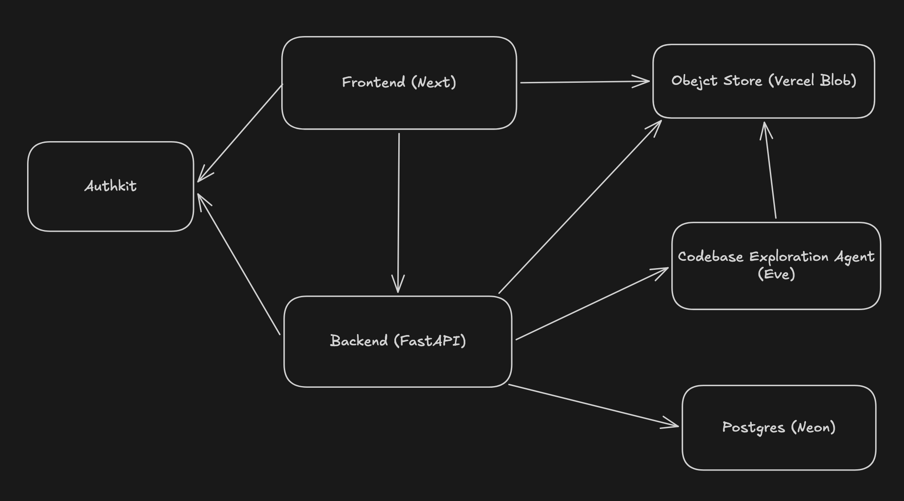

# System Wisdom

System wisdom is a tool to make it more clear which contributors understand which parts of a system or codebase. When large parts of codebases are AI generated or there are a large number of contributions to open source repos, it can become more difficult to understand who has fluency over which parts of the codebase. While it's possible for most engineers to use AI tools to work in most systems without as deep of an understanding as was once necessary, it can still be beneficial to have the ability to call on people who are highly fluent in parts of the system as needed. System wisdom helps determine this through the creation of custom assessments, the administration of those assessments, and a dashboard to easily visualize the information.

At a high level, the major components are a Next frontend, a FastAPI backend, and an Eve agent. It uses the agent to analyze your codebase, determine what the major parts or concepts of it are, and then uses those concepts to create an assessment for each of those individual concepts. Once your codebase has been analyzed and an assessment created, the assessment can be administered via a shareable link to your fellow contributors or peers. The results of the assessments are accessible to you via the dashboard so you can use that information to intelligently direct questions, bugs, or feature requests to the most likely person to be fluent in that particular subdomain.

## Problem

Within large codebases, especially codebases with large sections of generated code, it can be difficult to know who has a working understanding of parts of the system. Codebases are changing faster than ever, not least because of AI, and just because someone authored a PR, it doesn't necessarily imply that they understand the code being merged or the surrounding code it's being merged into, so commit history can become less reliable as an indicator of code or system ownership. Just because we have extremely powerful AI tools, it doesn't mean that we don't need engineers to know how the system works, that's still needed to direct the AI tools that we use to not take shortcuts, follow best practices, and ensure that the way a part of a system was intended to be extended is in fact the way that it gets extended! Obviously the ability for an engineer to work on an unknown system has increased with AI tools, but if we work on systems we do have a working knowledge of, it's likely our codebase will incorporate fewer bugs. This is quite pertinent in open source codebases, where contributions are quite distributed and ownership might be unclear.

## Key decisions:
- Frameworks
    - FastAPI backend
    - Next frontend
    - Eve agent
- Library choices
    - Sqlalchemy for an ORM
    - Alembic to manage db migrations
    - Pydantic for runtime type validation
    - Pydantic settings to type environment variables
    - Shadcn components
    - Tanstack form
    - HeyAPI to autogenerate an SDK from the backend's openapi spec
- Managed Services
    - Vercel Blob for object store
    - Workos for auth
    - Neon for postgres

## What was cut:
- Rather than making a github integration with a Github app, I decided to simply accept codebase uploads and put them in object store. My previous experience with Github Apps, and third party integrations generally, is that they're quite tedious to set up and are a minefield of gotchas. Given that the meat and potatoes of this project is the actual analysis of the codebase and administration of the assessments, and not the storage of the codebase, I decided to focus my time on the former rather than the latter.
- Another layer to the backend which would allow for an arbitrary system to interact with the backend and get the contributor understanding scores via API, and use that information to then intelligently route customer bug reports, github issues, etc. to the right individual. Basically, this would require setting up auth for API keys in the backend. Again, the core of the app is the agent, and extensions to the backend's auth system can be implemented in the future.
- Org management

